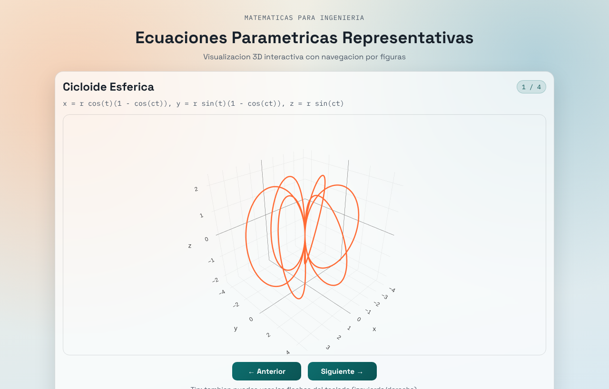
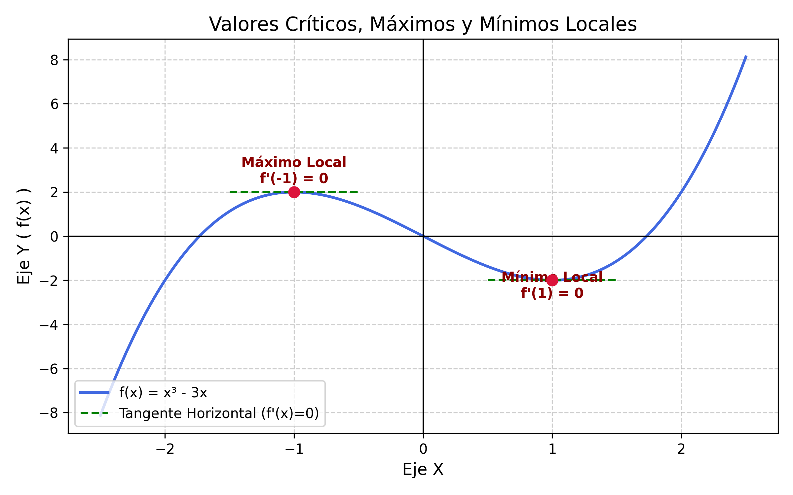
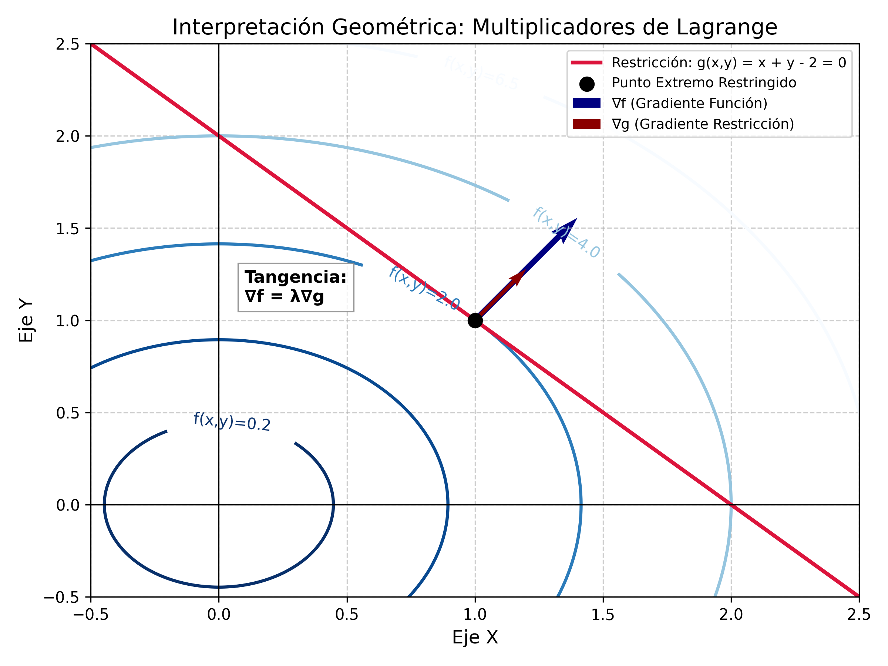

<div align="center">

# Matemáticas para Ingeniería

**Visualizaciones y comprobaciones de la materia Matemáticas para Ingeniería — UTT, 7mo cuatrimestre (EVND).**

[](https://github.com/RobiiAragon/MatematicasParaIngenieria/actions/workflows/ci.yml)     

[English](README.md) · **Español**

</div>

---

**[▶ Abrir el visor 3D interactivo](https://robiiaragon.github.io/MatematicasParaIngenieria/)**

<p align="center"></p>

## Qué hay aquí

| | |
| --- | --- |
| 🌐 [`docs/`](docs) | Visor web de curvas paramétricas 3D (Plotly): se navega con las flechas, tiene controles para cambiar los parámetros en vivo y un enlace propio para cada curva. |
| 📈 [`scripts/parametric_curves_3d.py`](scripts/parametric_curves_3d.py) | Las mismas curvas en Matplotlib, con botones para cambiar de figura. |
| 📉 [`scripts/assignment_2026-02-19.py`](scripts/assignment_2026-02-19.py) | Máximos, mínimos y multiplicadores de Lagrange (curvas de nivel). |
| 📐 [`scripts/p2t1_assignment.py`](scripts/p2t1_assignment.py) | Razón de cambio y derivadas parciales. |
| ▱ [`scripts/region_between_curves.py`](scripts/region_between_curves.py) | Región entre dos curvas para una integral doble. |
| ∫ [`transformada_de_laplace/`](transformada_de_laplace) | Ejemplos de transformada de Laplace comprobados con SymPy y SciPy. |

<p align="center">
  
  
</p>

## Correr los scripts

```sh
git clone https://github.com/RobiiAragon/MatematicasParaIngenieria.git
cd MatematicasParaIngenieria
python -m pip install -r requirements.txt
python scripts/parametric_curves_3d.py
```

## Pruebas

Cada script se ejecuta sin ventana, los resultados de Laplace se comparan con la salida registrada y el visor web se valida contra las curvas de Python:

```sh
python -m pip install -r requirements.txt -r transformada_de_laplace/requirements.txt pytest
python -m pytest -q
```

## Autores

Jesús Roberto Aragón López · Diana Carolina López Martínez

## Licencia

[MIT](LICENSE)

---

Hecho por **[Jesús Aragón](https://github.com/RobiiAragon)** · [Portafolio](https://robiiaragon.github.io/portfolio/)
