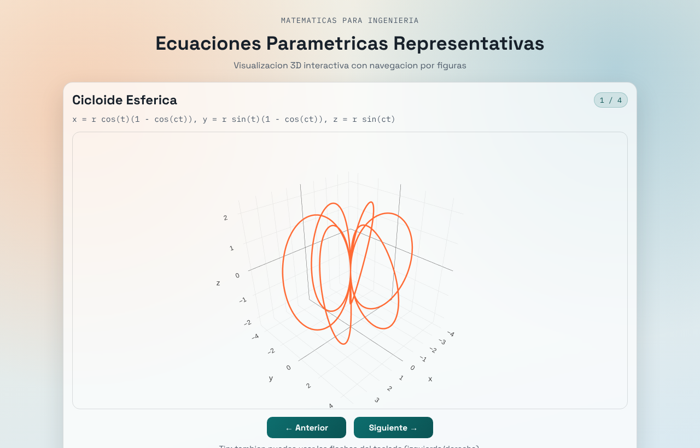
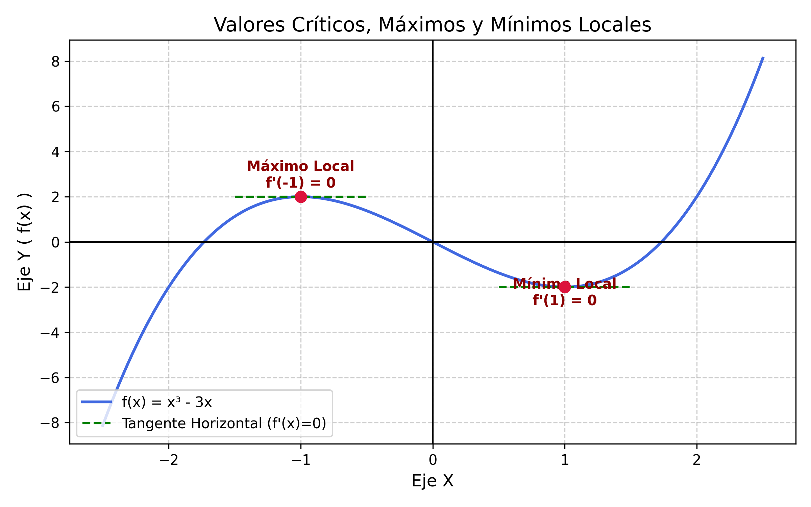
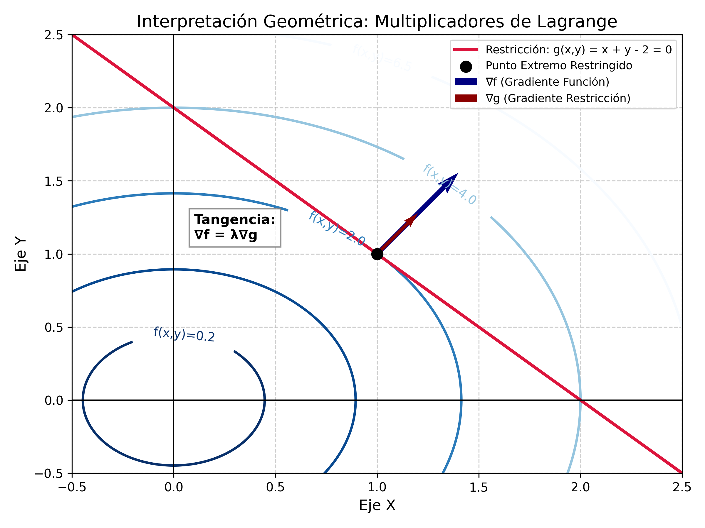

<div align="center">

# Math for Engineering

**Visualizations and checks for the Math for Engineering course — UTT, 7th term (EVND).**

[](https://github.com/RobiiAragon/MatematicasParaIngenieria/actions/workflows/ci.yml)     

**English** · [Español](README.es.md)

</div>

---

**[▶ Open the interactive 3D viewer](https://robiiaragon.github.io/MatematicasParaIngenieria/)**

<p align="center"></p>

## What's inside

| | |
| --- | --- |
| 🌐 [`docs/`](docs) | Web viewer of 3D parametric curves (Plotly): arrow-key navigation, live parameter sliders and a shareable link per curve. |
| 📈 [`scripts/parametric_curves_3d.py`](scripts/parametric_curves_3d.py) | The same curves in Matplotlib, with buttons to switch figures. |
| 📉 [`scripts/assignment_2026-02-19.py`](scripts/assignment_2026-02-19.py) | Maxima, minima and Lagrange multipliers (level curves). |
| 📐 [`scripts/p2t1_assignment.py`](scripts/p2t1_assignment.py) | Rate of change and partial derivatives. |
| ▱ [`scripts/region_between_curves.py`](scripts/region_between_curves.py) | Region between two curves for a double integral. |
| ∫ [`transformada_de_laplace/`](transformada_de_laplace) | Laplace transform examples checked with SymPy and SciPy. |

<p align="center">
  
  
</p>

## Run the scripts

```sh
git clone https://github.com/RobiiAragon/MatematicasParaIngenieria.git
cd MatematicasParaIngenieria
python -m pip install -r requirements.txt
python scripts/parametric_curves_3d.py
```

The plots and comments are in Spanish, as they were course assignments.

## Tests

Every script runs headless, the Laplace results are compared with the recorded output, and the web viewer is checked against the Python curves:

```sh
python -m pip install -r requirements.txt -r transformada_de_laplace/requirements.txt pytest
python -m pytest -q
```

## Authors

Jesús Roberto Aragón López · Diana Carolina López Martínez

## License

[MIT](LICENSE)

---

Made by **[Jesús Aragón](https://github.com/RobiiAragon)** · [Portfolio](https://robiiaragon.github.io/portfolio/)
